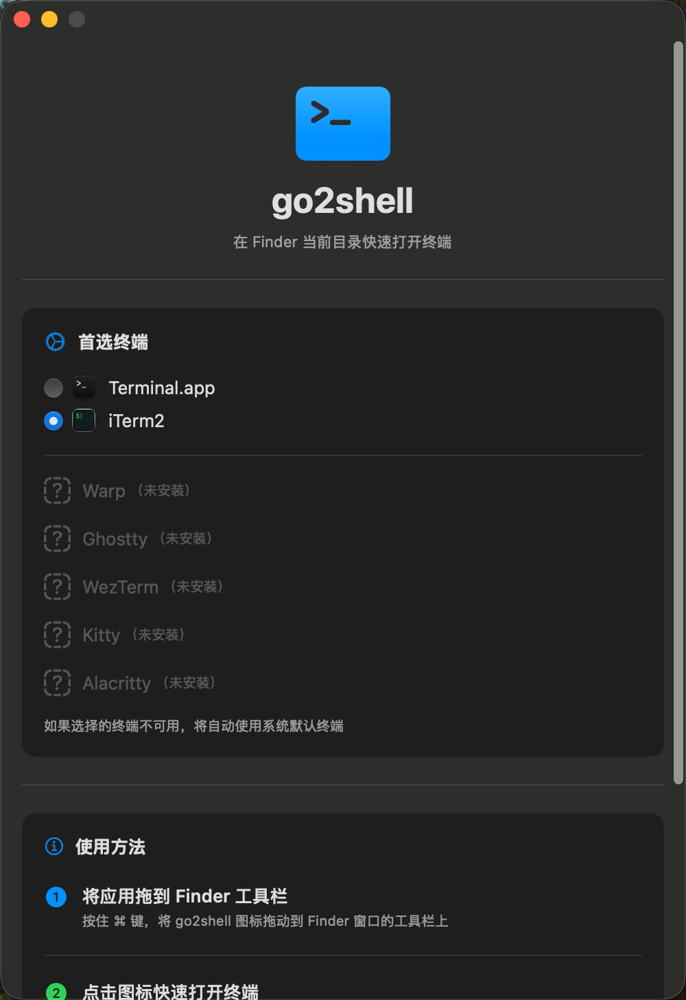

# go2shell

[简体中文](README_zh.md)

Open your preferred terminal in the folder you’re viewing in Finder.

## Install from source

Requires macOS 15 or later and an Xcode toolchain with Swift 6.3 or later. From the project directory, run:

```sh
make install
```

In Applications, hold **⌘ Command** and drag **go2shell.app** onto the Finder toolbar. Release it when the green plus appears. If macOS asks for permission to control Finder, click **Allow** so go2shell can read the current folder and selection.

## Open a terminal

| Finder selection | Where the toolbar button opens the terminal |
| --- | --- |
| No selection | The current Finder folder |
| A folder | The selected folder |
| A file | The folder containing the file |

With multiple items selected, go2shell uses the first item returned by Finder. With no selection or Finder window, it uses the Desktop.

## Settings

Double-click **go2shell.app** in Applications or **⌥ Option-click** its toolbar button to choose a terminal. You can keep settings open while using the toolbar. If go2shell.app itself is selected in Finder, a toolbar click also opens settings. Clear that selection to open a terminal in Applications.

go2shell prefers **iTerm2** when installed and otherwise uses **Terminal.app**. You can also select Warp, Ghostty, WezTerm, Kitty, or Alacritty. If your chosen terminal is unavailable, go2shell falls back to Terminal.app.



To open settings from the command line, run:

```sh
open -n /Applications/go2shell.app --args --settings
```

`--show-ui` also opens settings. Use `--open-terminal` to open the Finder directory even when go2shell.app is selected.

## Development

| Command | Result |
| --- | --- |
| `make build` | Build and locally sign `.build/go2shell.app` |
| `make run-settings` | Open the settings window from the build |
| `make icon` | Regenerate `Resources/AppIcon.icns` from `Resources/icon.png` |
| `make release` | Create a ZIP for the current architecture in `build/` |
| `make uninstall` | Remove the installed app from Applications |

[MIT license](LICENSE)
