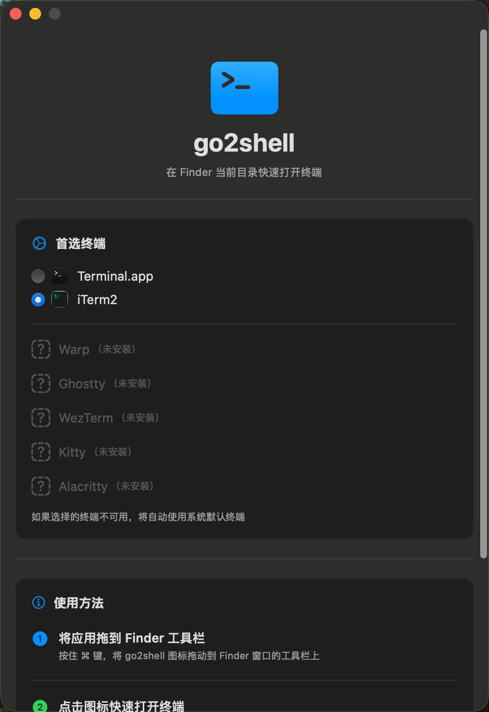

# go2shell

[English](README.md)

在 Finder 工具栏点一下，即可在正在浏览的目录打开首选终端。

## 从源码安装

需要 macOS 15 或更高版本，以及包含 Swift 6.3 或更高版本的 Xcode 工具链。在项目目录运行：

```sh
make install
```

打开“应用程序”，按住 **⌘ Command** 将 **go2shell.app** 拖到 Finder 工具栏，出现绿色加号后松手。如果 macOS 询问是否允许 go2shell 控制 Finder，点“允许”，应用即可读取当前目录和选中项。

## 打开终端

| Finder 中的选择 | 点击工具栏图标后打开终端的位置 |
| --- | --- |
| 未选中项目 | 当前 Finder 窗口的目录 |
| 选中文件夹 | 该文件夹 |
| 选中文件 | 文件所在的目录 |

选中多个项目时，使用 Finder 返回的第一项。没有打开 Finder 窗口且未选中项目时，使用桌面目录。

## 设置

在“应用程序”中双击 **go2shell.app**，或按住 **⌥ Option** 点击工具栏图标，即可选择终端。设置窗口打开时，仍可使用工具栏打开终端。如果 Finder 正选中 go2shell.app 本身，点击工具栏也会显示设置。要在“应用程序”目录打开终端，先取消选中应用本身。

已安装 **iTerm2** 时默认使用它，否则使用 **Terminal.app**。还可选择 Warp、Ghostty、WezTerm、Kitty 或 Alacritty。首选终端不可用时，自动回退到 Terminal.app。



从命令行打开设置：

```sh
open -n /Applications/go2shell.app --args --settings
```

`--show-ui` 也可打开设置。使用 `--open-terminal` 可以在选中 go2shell.app 本身时仍然打开终端。

## 开发命令

| 命令 | 用途 |
| --- | --- |
| `make build` | 构建并在本地签名，生成 `.build/go2shell.app` |
| `make run-settings` | 打开构建产物的设置窗口 |
| `make icon` | 使用 `Resources/icon.png` 重新生成 `Resources/AppIcon.icns` |
| `make release` | 在 `build/` 生成当前架构的 ZIP 压缩包 |
| `make uninstall` | 从“应用程序”移除已安装的 go2shell |

[MIT 许可证](LICENSE)
